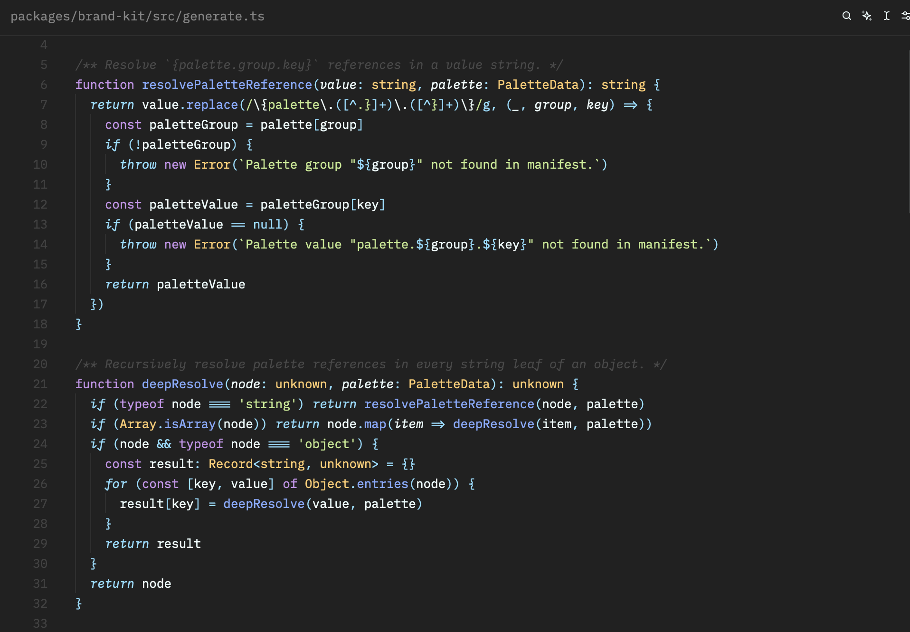

# Ramas

A Zed port of the open-source **Material Theme** (Apache-2.0). The flagship
**Ramas** variant is Material *Darker High Contrast*: graphite surfaces, a teal
accent and the classic Material syntax palette. It is tuned for
TypeScript/React and uses Zed's tree-sitter captures.

<!-- Add a screenshot:  -->

## Variants

| Theme | Based on Material… |
| --- | --- |
| **Ramas** | Darker High Contrast |
| Ramas Darker | Darker |
| Ramas Default / Default HC | Default |
| Ramas Ocean / Ocean HC | Ocean |
| Ramas Palenight / Palenight HC | Palenight |
| Ramas Deepforest / Deepforest HC | Deepforest |
| Ramas Lighter / Lighter HC | Lighter |

## Install

From Zed: run `zed: extensions` from the command palette and search for **Ramas**.
Then select it with `theme selector: toggle` (`cmd-k cmd-t`).

```jsonc
// settings.json
"theme": { "mode": "system", "dark": "Ramas", "light": "Ramas Lighter" }
```

## Recommended settings

Ramas is designed with the setup below. Zed themes can only define colours, so copy this into
your `settings.json` (`zed: open settings file`) to get the full look:

```jsonc
{
  "theme": { "mode": "system", "dark": "Ramas", "light": "Ramas Lighter" },
  "icon_theme": "Material Icon Theme",

  "ui_font_size": 15,
  "buffer_font_size": 13,
  "buffer_font_weight": 400,
  "buffer_line_height": "comfortable",
  "agent_ui_font_size": 13,
  "terminal": { "font_size": 12 },

  "project_panel": {
    "entry_spacing": "standard",
    "indent_size": 14,
    "auto_fold_dirs": true,
    "hide_root": true,
    "file_icons": true,
    "folder_indicator": "both"
  }
}
```

The icons come from the **Material Icon Theme** extension, which is installed separately
(`zed: extensions` → search "Material Icon Theme").

## Change the accent

All colours come from `palettes/material.json`. To change the accent, rebuild with one of
Material's accent presets, such as Acid Lime, Blue, Bright Teal, Cyan, Graphite, Indigo, Lime,
Orange, Pink, Purple, Red, Sky, Teal, Tomato or Yellow, or with any hex value:

```sh
python3 scripts/build.py --accent sky
python3 scripts/build.py --accent "#FF9800" --out ~/.config/zed/themes/ramas.json
```

## Syntax highlights (TS/TSX)

| Token | Colour |
| --- | --- |
| `const` `let` `function` `class` `type` `async` | purple |
| `import` `export` `return` `if` `await` | cyan, italic |
| functions & methods | blue |
| types, classes, JSX components | yellow |
| HTML/JSX tags | red |
| JSX props | purple |
| object literal keys | red |
| strings | green |
| numbers | orange |
| booleans | pink |
| `this`, `null`, `undefined` | cyan |
| parameters, comments | italic |

## Credits & license

Ramas is licensed under the [Apache License 2.0](LICENSE).

The colour palettes and colour derivation come from the
[Material Theme](https://github.com/t3dotgg/vsc-material-but-i-wont-sue-you) (Apache-2.0),
originally created by Mattia Astorino and contributors. See [NOTICE](NOTICE) for details.

Ramas is not affiliated with the Material Theme or Vira Theme authors.
